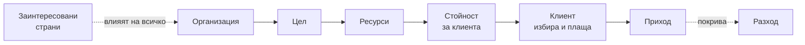

# Модул 01. Преговор: бизнес основи преди мениджмънта

## Цели на урока

След този урок ученикът може да:

* обясни със свои думи седемте понятия, на които стъпва управлението: организация, ресурс, приход и разход, клиент, стойност, stakeholder (заинтересована страна) и цел;
* различи клиента, който плаща, от клиента, който избира;
* пресметне печалба или загуба от прости данни за приходи и разходи;
* превърне едно желание в цел с число и срок;
* приложи седемте понятия върху реален малък бизнес.

## 1. Защо започваме с преговор

В предходните години си учил предприемачество, икономика, маркетинг, финанси и комуникации. Мениджмънтът не е нов предмет, който започва от нулата. Той е мястото, където всичко това се събира и се превръща в **решения**.

Представи си, че влизаш в кухнята на ресторант. Продуктите са на масата: брашно, яйца, зеленчуци. Мениджмънтът е готвачът, който решава какво, кога и в какъв ред да сготви, за да излезе ястие, което клиентът ще плати. Ако не познаваш продуктите, не можеш да готвиш.

Затова първият модул е речник. Седем думи, без които не можем да говорим за управление.

> **Опитай сам.** Запиши за 2 минути всички думи, които свързваш с „бизнес“. После ги огради с един цвят, ако са свързани с пари, с друг, ако са свързани с хора. Кои останаха неоградени?

## 2. Организация

**Организация** е група хора, обединени около обща цел, с правила и разпределени роли.

Три белега я отличават от случайна група:

1. **Обща цел.** Всички знаят защо са заедно.
2. **Правила.** Писани или неписани: кога започваме, кой какво може да реши.
3. **Роли.** Всеки има своя задача.

Billa е организация. Футболният клуб в квартала е организация. Вашият клас също е организация: има обща цел (да завършите), правила (училищен правилник, разписание) и роли (класен ръководител, отговорник на класа, ученици).

Опашката пред касата в Billa **не е** организация. Хората там имат подобни цели, но не обща, нямат роли и никой не ги разпределя.

### Пример: Viber групата на класа

Viber групата е интересен граничен случай. Има хора и нещо като правила („без спам след 22:00“). Но обща цел? Ролите? Обикновено групата е **инструмент** на организацията (класа), а не самостоятелна организация. Ако обаче група родители се събере в Viber, за да организира абитуриентския бал, разпредели кой отговаря за ресторанта, кой за музиката и кой за бюджета, тя започва да прилича на организация.

> **Опитай сам.** Кое от тези е организация и защо: доброволците на Българския Червен кръст, публиката на мач на ЦСКА, отборът по роботика на училището, хората, които следят един и същ TikTok профил?

## 3. Ресурс

**Ресурс** е всичко, с което постигаме целта. Обикновено ги делим на пет вида:

| Вид ресурс | Какво включва | Пример от кафене |
|---|---|---|
| **Човешки** | хора, знания, умения, време на хората | двама баристи, един управител |
| **Финансови** | пари, кредит, оборотни средства | 3 000 € в банката за наем и доставки |
| **Материални** | сграда, техника, суровини | машина за еспресо, 40 кг кафе на месец |
| **Информационни** | данни, знания за клиентите, рецепти | кои напитки се продават в понеделник сутрин |
| **Време** | срокове, работни часове | отваряме в 7:00, сутрешният пик е до 9:30 |

Най-важното за ресурса: **винаги е ограничен**. Ако имахме безкрайно хора, пари и време, нямаше да има нужда от управление. Щяхме просто да правим всичко. Мениджърът съществува, защото трябва да **избира** къде да вложи ограничения ресурс.

> **Опитай сам.** Твоят клас организира турнир по футбол на малки вратички. Изброй по два ресурса от всеки вид. Кой ресурс ще свърши първи?

## 4. Приход и разход

**Приходът** е парите, които влизат. **Разходът** е парите, които излизат. Разликата е **печалба** (ако приходът е по-голям) или **загуба** (ако разходът е по-голям).

Пример от кафене в центъра на Пловдив за един ден:

| | Сума |
|---|---|
| 180 кафета по 2,20 € | 396 € приход |
| Кафе, мляко, чаши | 85 € |
| Дневен дял от наема (1 500 € месечно) | 50 € |
| Заплати за деня (двама баристи) | 160 € |
| Ток, вода, софтуер за касата | 25 € |
| **Общо разходи** | **320 €** |
| **Печалба за деня** | **76 €** |

Обърни внимание: някои разходи се променят с продажбите (мляко, кафе, чаши). Наричаме ги **променливи разходи**. Други остават същите, дори да не продадеш нито едно кафе (наем, заплати). Наричаме ги **постоянни разходи**. Мениджърът, който не различава двата вида, не може да реши дали си струва да отвори в неделя.

> **Опитай сам.** Колко кафета трябва да продаде кафенето, за да покрие разходите си за деня? Подсказка: от всяко кафе за 2,20 € около 0,47 € отиват за кафе, мляко и чаша. Останалите покриват постоянните разходи.

## 5. Клиент

**Клиентът** е този, който избира и плаща. Понякога това са двама различни души.

* Родителят плаща курса по програмиране, но детето го избира или поне трябва да иска да ходи.
* Фирмата плаща обяда на служителите в ресторанта, но служителят избира ястието.
* Общината плаща ремонта на парка, но гражданите решават дали ще го използват.

Това има голямо значение за управлението. Ако продаваш курс по английски, трябва да убедиш родителя (че е полезно и сигурно) и детето (че е интересно). Двете послания са различни.

### Пример: SoftUni Buditel

Кой е клиентът на вашето училище? Родителят, който подписва договора и плаща? Ученикът, който всеки ден решава дали му е интересно? Бъдещият работодател, който ще наеме завършилия? Всички са важни, но по различен начин. Добрият мениджър на училище мисли и за трите.

> **Опитай сам.** Посочи три продукта или услуги, при които плащащият и използващият са различни хора. За всеки напиши какво иска единият и какво иска другият.

## 6. Стойност

**Стойността** е ползата, която клиентът усеща, спрямо цената, времето и усилието, които дава.

Проста формула за запомняне:

**Стойност = Полза, която получавам − (Цена + Време + Усилие)**

Ключово: **стойността я определя клиентът, не продавачът**. Пекарят може да е горд с ръчно месената си питка, но ако клиентът бърза и иска само нещо бързо за закуска, той ще оцени повече кифлата, която взима за 20 секунди.

Защо някои хора плащат 5 € за кафе в Starbucks, а други пият кафе от машина за 0,80 €? Защото за тях стойността е различна. Едните плащат за атмосфера, място за среща, марка. Другите за кофеин и бързина.

> **Опитай сам.** Сравни стойността на една и съща пица, поръчана през Glovo, и взета лично от пицарията. Какво се променя в ползата, цената, времето и усилието?

## 7. Stakeholder (заинтересована страна)

**Stakeholder** е всеки, който влияе на организацията или е засегнат от нея.

За една пекарна в Люлин това са:

* **собственикът**, който е вложил парите;
* **служителите**, за които това е заплата;
* **клиентите**, които купуват закуска;
* **доставчикът на брашно**, за когото пекарната е клиент;
* **съседите**, които чуват камиона за доставки в 5 сутринта;
* **общината**, която издава разрешително и събира такси;
* **БАБХ** (Българската агенция по безопасност на храните), която проверява хигиената.

Мениджърът не може да угоди на всички едновременно. Но трябва да ги **познава**, защото всеки от тях може да спре или да помогне на бизнеса. В модул 08 ще научиш как да ги подредиш по власт и интерес.

> **Опитай сам.** Изброй поне шест заинтересовани страни на вашето училище. Кои от тях имат най-голяма власт да променят нещо?

## 8. Цел

**Целта** е желан резултат **с число и срок**.

| Желание | Цел |
|---|---|
| „Да растем.“ | „+15% продажби до 30 юни 2027 г.“ |
| „Да сме известни.“ | „1 000 последователи в Instagram до края на първия срок.“ |
| „Да имаме доволни клиенти.“ | „Средна оценка 4,7 от 5 в Google Maps до март.“ |
| „Да учим повече.“ | „Среден успех 5,50 на класа за втория срок.“ |

Без число не можем да разберем дали сме я постигнали. Без срок можем винаги да кажем „още не, но ще стане“.

В модул 02 ще видиш, че добрата цел има още две неща: **източник** (откъде ще вземем числото) и **собственик** (кой отговаря за нея).

> **Опитай сам.** Превърни в цел с число и срок: „Искам да чета повече“, „Нашият клуб иска повече членове“, „Магазинът иска по-малко жалби“.

## 9. Седемте понятия заедно

Понятията не съществуват поотделно. Те образуват една верига:

Организацията си поставя цел. За да я постигне, използва ресурси. С тях създава стойност. Клиентът я оценява, избира и плаща. Приходът трябва да покрие разхода. И през цялото време заинтересованите страни влияят на всичко.

### Пример: „Хлебарницата на Мария“ в Люлин

Мария има малка пекарна с 4 души. Отваря в 6:30 и продава около 600 закуски на ден.

| Понятие | Какво е при Мария | Какво решение зависи от това |
|---|---|---|
| Организация | Мария, двама продавачи и пекар | Кой отваря в 6:30 и кой затваря |
| Ресурс | 4 души, фурна, около 2 000 € оборотни средства, рецепти | Дали да купи втора фурна или да наеме още един пекар |
| Приход и разход | около 600 € оборот на ден; брашно, заплати, наем, ток | Дали да вдигне цената на баницата с 0,20 € |
| Клиент | хора на път за работа, ученици, майки с деца | Дали да отваря в 6:00, а не в 6:30 |
| Стойност | топла закуска за под минута, на път за метрото | Дали да въведе плащане с карта на всяка каса |
| Stakeholder | доставчикът на брашно, съседите, общината, БАБХ | Как да организира ранните доставки, без да буди съседите |
| Цел | 700 закуски на ден до края на март | Дали да пусне сутрешна оферта „закуска и кафе за 2,50 €“ |

> **Опитай сам.** Направи същата таблица за бизнес, който познаваш лично: фризьорски салон, магазин в квартала, спортна зала.

## Въпроси за дискусия

1. Може ли една организация да има само разходи и никакви приходи и пак да е успешна? Помислете за училище, болница, фондация.
2. Кой е клиентът на Google, ако търсенето е безплатно?
3. Защо „да растем“ звучи като цел, но не е?
4. Кога интересите на две заинтересовани страни са в пряк конфликт? Дайте пример от вашия град.

## Ключови термини

| Термин | Значение |
|---|---|
| Организация | хора, обединени около обща цел, с правила и роли |
| Ресурс | всичко, с което постигаме целта; винаги е ограничен |
| Приход / разход | парите, които влизат / излизат |
| Постоянни / променливи разходи | не зависят / зависят от обема на продажбите |
| Клиент | този, който избира и плаща |
| Стойност | ползата спрямо цената, времето и усилието |
| Stakeholder | заинтересована страна |
| Цел | желан резултат с число и срок |
