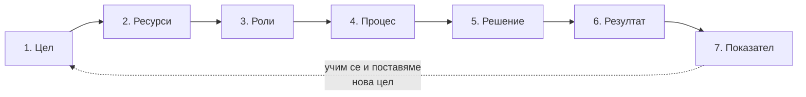
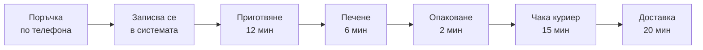

# Модул 02. Преговор: план, процес, екип, решение и KPI

## Цели на урока

След този урок ученикът може да:

* опише управленската верига в седем стъпки: цел, ресурси, роли, процес, решение, резултат, показател;
* разпознае коя стъпка липсва в реален проект;
* начертае прост процес и да открие тясното място в него;
* разграничи слаб от силен KPI (ключов показател за ефективност);
* формулира KPI с число, срок, източник и собственик.

## 1. Една логика, която се повтаря

В модул 01 научи думите. Сега ще ги подредим в изречение. Всеки мениджър, независимо дали управлява Lidl България, училищен базар или собствената си седмица, минава през едни и същи седем стъпки:

| Стъпка | Въпрос | Какво се случва, ако липсва |
|---|---|---|
| **1. Цел** | Какво точно искаме и до кога? | Всеки тегли в различна посока |
| **2. Ресурси** | С какви хора, пари и време разполагаме? | Обещаваме повече, отколкото можем |
| **3. Роли** | Кой за какво отговаря? | „Мислех, че ти ще го направиш.“ |
| **4. Процес** | В какъв ред се случва работата? | Хаос, повторения, забравени стъпки |
| **5. Решение** | Кой вариант избираме и защо? | Безкрайни обсъждания, нищо не тръгва |
| **6. Резултат** | Какво реално се случи? | Не знаем докъде сме стигнали |
| **7. Показател** | С какво число го доказваме? | Не знаем дали е било успешно |

Ако една стъпка липсва, веригата се къса. В ученическите проекти най-често липсва седмата: правим много, но накрая не знаем дали е било успешно.

> **Опитай сам.** Спомни си последния групов проект, в който си участвал. Коя от седемте стъпки липсваше или беше най-слаба? Какво се случи заради това?

## 2. Цел и ресурси

Целта казва **къде**. Ресурсите казват **с какво**. Двете трябва да си пасват.

Ако целта е „1 500 € дарение“, а ресурсите са 3 доброволци и една седмица, целта вероятно е нереалистична. Ако целта е „200 € дарение“, а имаме 30 доброволци и месец, вероятно хабим ресурс.

Добрият мениджър винаги сверява двете. Въпросът е: **„Достатъчно ли е това, с което разполагаме, за това, което обещаваме?“**

## 3. Роли

Ролята отговаря на въпроса **кой отговаря**. Важно е да различим:

* **Кой прави** работата.
* **Кой отговаря** за резултата (само един човек!).
* **С кого се съгласува** преди решение.
* **Кого информираме** след това.

Този модел се нарича **RACI** (Responsible, Accountable, Consulted, Informed, тоест изпълнява, отговаря, консултира се, информира се).

### Пример: RACI за училищния бал

| Задача | Изпълнява | Отговаря | Консултира се | Информира се |
|---|---|---|---|---|
| Избор на ресторант | двама ученици | председателят на випуска | класните ръководители | всички родители |
| Музика и DJ | трима ученици | Ния | випускът (гласуване) | ресторантът |
| Бюджет и плащания | касиерът | касиерът | родителски комитет | всички |

Правилото: **за всяка задача само един човек отговаря**. Ако отговарят двама, никой не отговаря.

> **Опитай сам.** Направи RACI таблица за три задачи от организацията на коледно тържество в класа.

## 4. Процес

**Процесът** е редът, в който се случва работата. Най-лесно се вижда, когато го начертаеш.

Пример за поръчка в пицария:

Къде губим най-много време? Не в кухнята, а в **чакането на куриер**. Това се нарича **тясно място** (bottleneck, „гърлото на бутилката“). Ако искаш по-бърза доставка, няма смисъл да купуваш по-бърза фурна. Трябва още един куриер или по-добро разпределение на поръчките.

> **Опитай сам.** Начертай процеса на сутрешното ти тръгване за училище, от събуждането до влизането в клас. Къде е тясното място?

## 5. Решение

На всяка стъпка има избор. Решението е моментът, в който спираме да обсъждаме и **избираме вариант**. В модул 05 ще научиш цял процес за това. Засега помни три неща:

1. Добрите решения имат **поне две реални алтернативи**.
2. Решението има **критерий**: по какво избираме (цена, време, качество).
3. Някой **поема отговорност** за него.

## 6. Резултат и показател

**Резултатът** е това, което реално се случи. **Показателят** е числото, с което го доказваме.

### Пример: Коледният базар на класа

| Стъпка | Как изглежда в базара |
|---|---|
| Цел | 1 500 € за дарение на детско отделение до 18 декември |
| Ресурси | 14 доброволци, 3 маси във фоайето, 200 € за материали, 2 седмици |
| Роли | координатор, каса, производство, социални мрежи, отчет |
| Процес | изработка → реклама → продажба в 3 големи междучасия → преброяване → отчет |
| Решение | една цена 5 € или три нива: 3, 6 и 10 €? Избрахме трите нива |
| Резултат | 1 320 € за 3 дни |
| Показател | 88% изпълнение на целта; 216 продажби; среден чек около 6,10 € |

Целта не е постигната. **Провал ли е това?** Не непременно. Показателите ни казват много:

* Средният чек от 6,10 € показва, че решението с трите цени е работило (по-високо от единната цена от 5 €).
* 216 продажби за 3 междучасия са около 72 на междучасие. Може би масите са били малко и опашката е отказвала хората.
* Догодина можем да добавим четвърто междучасие или четвърта маса, вместо да вдигаме цените.

Това е смисълът на показателя: **не да ни даде оценка, а да ни подскаже следващото решение**.

> **Опитай сам.** Ако догодина целта е 2 000 €, кое от изброените би променил първо: броя доброволци, броя маси, цените или продължителността? Защо?

## 7. KPI: добър показател или просто число?

**KPI** (key performance indicator, ключов показател за ефективност) показва дали се движим към целта.

Добрият KPI има четири части:

1. **Число** (колко?)
2. **Срок** (до кога?)
3. **Източник** (откъде ще вземем числото?)
4. **Собственик** (кой отговаря за него?)

| Слабо | Силно | Какво добавихме |
|---|---|---|
| „Повече последователи“ | +300 последователи в Instagram до 31 януари | число и срок |
| „Доволни клиенти“ | Средна оценка 4,6 от 5 в Google до края на срока | измерим източник |
| „Да продаваме добре“ | 70 продадени абонамента месечно, отговаря Ива | собственик |
| „Бърза доставка“ | 95% от поръчките в София доставени до 24 часа | праг и обхват |

### Капанът на „суетните“ показатели

Някои числа изглеждат добре, но не казват нищо за целта. Наричат се **vanity metrics** (суетни показатели).

* Харесванията на пост, ако целта е продажби.
* Броят изпратени имейли, ако целта е записвания.
* Броят часове, прекарани в офиса, ако целта е готов проект.

Въпросът за проверка е: **„Ако това число се удвои, ще сме ли по-близо до целта?“** Ако отговорът е „не непременно“, показателят е суетен.

> **Опитай сам.** Превърни „Да сме по-добър клас“ в един силен KPI. Кой ще отговаря за него? Откъде ще вземете числото?

## 8. Водещи и изоставащи показатели

Някои показатели ни казват какво **вече** се е случило. Наричат се **изоставащи** (lagging). Пример: годишният успех, продажбите за месеца.

Други ни подсказват какво **ще** се случи. Наричат се **водещи** (leading). Пример: колко домашни са предадени навреме тази седмица, колко хора са сложили продукт в количката.

Изоставащият показател е като огледалото за обратно виждане. Водещият е като предното стъкло. Добрият мениджър гледа и двете, но управлява основно чрез водещите, защото по тях още може да се коригира.

| Цел | Изоставащ показател | Водещ показател |
|---|---|---|
| Среден успех 5,50 на класа | Срочната оценка | % предадени домашни всяка седмица |
| 100 нови членове на фитнеса | Нови договори за месеца | Брой пробни тренировки тази седмица |
| 1 500 € от базара | Сумата в касата накрая | Изработени продукти до петък |

> **Опитай сам.** Твоята цел е да пробягаш 5 км под 30 минути до май. Посочи един изоставащ и два водещи показателя.

## Въпроси за дискусия

1. Защо в ученическите проекти най-често липсва седмата стъпка?
2. Може ли твърде много показатели да навредят? Колко KPI е разумно да има един екип?
3. Кога е по-добре да не постигнеш целта, но да научиш нещо, отколкото да я постигнеш случайно?
4. Ако двама души отговарят за една задача, какво обикновено се случва?

## Ключови термини

| Термин | Значение |
|---|---|
| Управленска верига | цел, ресурси, роли, процес, решение, резултат, показател |
| RACI | изпълнява, отговаря, консултира се, информира се |
| Bottleneck | тясно място, „гърлото на бутилката“ в процеса |
| KPI, key performance indicator | ключов показател за ефективност |
| Vanity metrics | суетни показатели, които изглеждат добре, но не показват напредък |
| Leading / lagging indicator | водещ / изоставащ показател |
