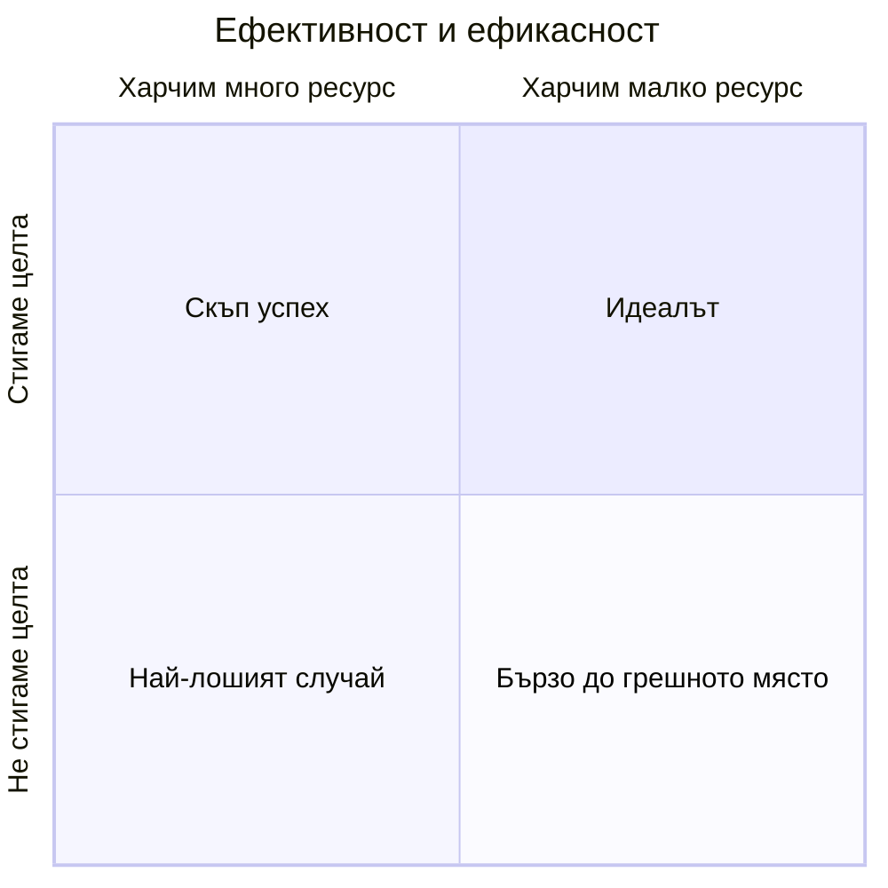
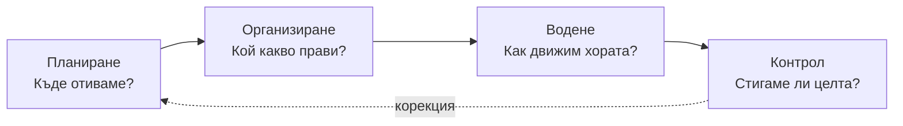

# Модул 03. Какво управлява мениджърът?

## Цели на урока

След този урок ученикът може да:

* разграничи управление, организация, мениджър и изпълнител;
* обясни разликата между effectiveness (ефективност) и efficiency (ефикасност) с примери;
* опише четирите функции на управлението: планиране, организиране, водене и контрол;
* представи петте функции на мениджмънта според Анри Файол и според Питър Дракър;
* сравни трите модела и прецени кой пасва на конкретна организация.

## 1. Входна диагностика

Преди урока отговори кратко и честно на пет въпроса. Няма оценка. Отговорите показват откъде тръгваме. В края на урока ще се върнеш към тях.

1. Управителката на магазин на Lidl застава на касата, защото опашката е огромна. В този момент управлява ли или изпълнява?
2. Два екипа пекат по 100 козунака. Единият изразходва 40 кг брашно, другият 55 кг. Кой е по-ефикасен? Знаем ли кой е по-ефективен?
3. Кое е организация: класът ви, Viber групата на класа или опашката в Billa?
4. Мениджър проверява всичко, но никога не планира. Какво ще се счупи първо?
5. Може ли човек без нито един подчинен да бъде мениджър?

## 2. Четири думи, които често бъркаме

| Понятие | Какво означава |
|---|---|
| **Управление** | Процесът, чрез който постигаме цели **с други хора и чрез тях**, като използваме ресурсите разумно. |
| **Организация** | Структурата, в която се случва управлението: цел, хора, правила, роли. |
| **Мениджър** | Отговаря за **резултата на други хора**. Планира, разпределя, решава, следи. |
| **Изпълнител** | Отговаря за **собствената си задача**. Често е експерт, който знае повече от мениджъра си. |

Ключът е в това **за чий резултат отговаряш**. Мениджърът отговаря за резултата на другите, изпълнителят за своя. Титлата на визитката не решава кой кой е.

Управителката на Lidl, която застава на касата, в този момент **изпълнява**. Това не е грешка. Понякога е точното решение. Но ако тя стои на касата цял ден, никой не управлява магазина: никой не следи наличностите, не разпределя смените, не забелязва, че хладилната витрина не работи.

### Пример: старшият програмист, който стана тийм лидер

Мартин е най-добрият програмист в софийска IT компания. Повишават го за тийм лидер на 6 души. Първия месец той продължава да пише най-трудния код сам, защото „така е по-бързо“. Екипът чака неговите решения, срещите се отлагат, двама души нямат задачи. В края на месеца Мартин е написал много код, но екипът е изостанал.

Мартин още не е разбрал, че работата му се е сменила. Вече не се мери с неговия код, а с **резултата на шестимата**.

> **Опитай сам.** Може ли човек без нито един подчинен да бъде мениджър? Помисли за проектен мениджър, който координира хора от други отдели, или за ученик, който организира базара. Какво управлява той?

## 3. Effectiveness и efficiency

Двете думи на български звучат почти еднакво, но означават различни неща. Питър Дракър ги различава така:

* **Effectiveness (ефективност):** правим **правилните неща**. Постигаме целта.
* **Efficiency (ефикасност):** правим нещата **правилно**. Харчим минимум ресурс.

| | Ефективност | Ефикасност |
|---|---|---|
| Въпрос | Постигнахме ли целта? | Колко ресурс похарчихме? |
| Пример от Speedy | Пратката стига навреме на правилния адрес | Куриерът минава по маршрут, който спестява 18 км гориво на ден |
| Пример от училище | Целият клас взима матурата | Подготовката става с 2 часа седмично вместо с 5 |

**Ефикасност без ефективност** означава бързо и евтино да стигнеш до грешното място. Фабрика може да произвежда най-евтините калъфи за телефони в света, но ако никой не иска този модел, ефикасността ѝ е безполезна.

Обратно към входната диагностика: екипът с 40 кг брашно е по-ефикасен. Но не знаем дали е ефективен, докато не проверим дали козунаците му са вкусни и се продават.

> **Опитай сам.** Дай пример от училище, в който сте били ефективни, но не и ефикасни. После пример, в който сте били ефикасни, но не и ефективни.

## 4. Четирите функции на управлението

Съвременните учебници описват работата на мениджъра с четири функции. Ще ги проследим върху пример: **училищен фестивал на ученическите компании**.

| Функция | Въпрос | Какво правим | Във фестивала |
|---|---|---|---|
| **Планиране** | Къде отиваме? | Поставяме цели и избираме път | Фестивал за 300 посетители на 15 май, 12 щанда |
| **Организиране** | Кой какво прави? | Разпределяме хора, задачи и ресурси | Екипи за щандове, сцена и реклама; бюджет по екипи |
| **Водене** (leading, лидерство) | Как движим хората? | Мотивираме, комуникираме, решаваме спорове | Координаторът подкрепя екипите и разрешава конфликт за мястото на щандовете |
| **Контрол** | Стигаме ли целта? | Сравняваме резултата с плана и коригираме | Седмична проверка: 9 от 12 щанда, 180 от 300 билета |

Функциите не вървят строго една след друга. Мениджърът ги прави едновременно, всеки ден. Но ако една липсва, проблемът се вижда бързо:

* Без **планиране**: всички работят усилено, но в различни посоки.
* Без **организиране**: двама правят едно и също, а друго никой не прави.
* Без **водене**: планът е добър, но хората нямат мотивация и се карат.
* Без **контрол**: разбираме, че нещо не е наред, едва в деня на фестивала.

> **Опитай сам.** Върни се на въпрос 4 от диагностиката: мениджър проверява всичко, но никога не планира. Какво ще се счупи първо? Отговори с понятията от таблицата.

## 5. Класическият модел: петте функции на Файол

**Анри Файол** е френски минен инженер и директор на голяма минна компания. През 1916 г. издава книгата „Индустриална и обща администрация“. Това е първото описание на управлението като **отделна професия**, различна от инженерството или счетоводството.

Файол описва пет функции:

| № | Функция | Какво означава |
|---|---|---|
| 1 | **Планиране** | Да предвидим бъдещето на организацията и да определим мерките, които ще ни отведат там. |
| 2 | **Организиране** | Да осигурим всичко нужно за работата: суровини, инструменти, капитал и персонал. |
| 3 | **Разпореждане** | Да получим най-добрия ефект от усилията на хората в интерес на цялата организация. |
| 4 | **Координиране** | Да постигнем хармония между дейностите и да балансираме разходите, производството, наличностите и търсенето. |
| 5 | **Контролиране** | Да проверим дали всичко съответства на плановете и стандартите и да не допуснем грешките отново. |

Файол казва, че контролът засяга всичко: продукти, хора и работни операции.

### Как изглеждат функциите на практика

**Планиране: идеалният план.** Според Файол добрият план има четири качества:

* **целенасоченост:** плановете на отделните звена поддържат общия план;
* **непрекъснатост:** планът е част от непрекъснат процес, не еднократно упражнение;
* **гъвкавост:** оставя място за неочакваното;
* **точност:** толкова прецизен, колкото е възможно.

Файол препоръчва прогнози за ден, седмица, месец, година, пет и десет години, които се коригират навреме.

**Организиране: пирамидата.** Формата на организацията зависи най-вече от броя на хората. На всеки 10, 20 или 30 работници трябва майстор. Над няколко майстори стои по-висш ръководител, и така до върха. Правилото на Файол: **един началник да няма повече от 4 или 5 преки подчинени** на по-високите нива.

**Разпореждане и координиране: правилата на ръководителя.**

* Опознай подчинените си.
* Бори се с некомпетентността.
* Давай добър личен пример.
* Не потъвай в дребни детайли.
* Делегирай права и помагай с подсказване, не вместо човека.
* Провеждай ежедневни кратки съвещания за изпълнението, не за планиране.

### Пример: Файол днес

Последното правило звучи изненадващо модерно. Почти всеки софтуерен екип днес прави **daily stand-up** (ежедневна кратка среща прав): 15 минути, всеки казва какво е свършил вчера, какво ще прави днес и какво го спира. Това е почти дословно идеята на Файол отпреди повече от век.

> **Опитай сам.** Правилото „не повече от 5 преки подчинени“ спазва ли се във вашето училище? Колко учители има един директор? Какво би казал Файол?

## 6. Съвременният модел: петте функции на Дракър

**Питър Дракър** (1909 до 2005) е австрийско-американски мислител, наричан „бащата на съвременния мениджмънт“. Той поставя **хората и техните резултати** в центъра. Развитието на хората изобщо липсва при Файол.

| № | Функция | Какво прави мениджърът | Какво качество иска |
|---|---|---|---|
| 1 | **Определяне на цели** | Поставя цели на човек, екип или организация, разбива ги на подцели и ги обяснява на хората | анализ и синтез |
| 2 | **Организиране** | Подрежда оскъдните ресурси, разделя работата на управляеми дейности, групира звена и избира хора | анализ и честност |
| 3 | **Мотивиране и комуникиране** | Създава сплотени екипи чрез признание, възнаграждение и кариерно развитие | синтез и справедливост |
| 4 | **Измерване** | Определя еталони (стандарти) за всеки служител, анализира, оценява и тълкува изпълнението | анализ без натиск |
| 5 | **Развитие** | Развива хората и себе си | пример и честност |

Всеки ръководител изпълнява тези пет функции, каквото и да ръководи.

### Три идеи на Дракър, които променят управлението

**Целите са въпрос на баланс.** Между бизнес резултатите и принципите, в които вярваш. Между нуждите днес и тези на бъдещето. Между желаните резултати и наличните средства. Затова поставянето на цели иска умение да анализираш и да обединяваш.

**Мотивацията е разговор.** Дракър подчертава, че мотивацията иска постоянна комуникация **в двете посоки**: от мениджъра към служителя и от служителя към мениджъра. При мотивирането справедливостта е по-важна от икономическите сметки.

**Измерването не е средство за контрол.** Докато на измерването се гледа като на средство за натиск, то остава най-уязвимото звено в работата на ръководителя. Добрият еталон помага на човека да върши работата си, а не го притиска отгоре.

За развитието Дракър пише, че мениджърът или насочва хората, или ги обърква; или разкрива качествата им, или ги потиска. Неутрален мениджър няма.

> **Опитай сам.** Спомни си треньор, учител или ръководител, който е развил нещо в теб. Коя от петте функции на Дракър е изпълнявал най-добре?

## 7. Три модела, една и съща работа

| Днешният модел (4 функции) | Файол, 1916 (5 функции) | Дракър (5 функции) |
|---|---|---|
| Планиране | Планиране | Определяне на цели |
| Организиране | Организиране | Организиране |
| Водене | Разпореждане и координиране | Мотивиране и комуникиране |
| Контрол | Контролиране | Измерване |
| | | Развитие |

Различни думи, но една и съща логика. Разликите показват как се променя разбирането за мениджъра:

* **Файол** гледа на управлението като на **ред и контрол**. Организацията е машина, която трябва да работи без засечки.
* **Дракър** гледа на управлението като на **работа с хора**. Организацията е общност, която трябва да расте.
* **Днешният модел** е компромисът: кратък, лесен за запомняне, но губи функцията „развитие“.

> **Опитай сам.** Кой от двата модела, на Файол или на Дракър, би избрал за ученически стартъп и кой за болница? Защо? Има ли организация, където трябват и двата?

## 8. Обратно към диагностиката

Върни се на петте въпроса от началото. Промени ли се някой твой отговор? Запиши с друг цвят новия отговор и едно изречение защо.

## Въпроси за дискусия

1. Защо най-добрият изпълнител често не е най-добрият мениджър?
2. Файол пише през 1916 г. за минна компания. Кое от неговите правила е напълно остаряло и кое важи и днес?
3. Дракър казва, че измерването не трябва да е средство за натиск. Как е при оценяването в училище?
4. Защо функцията „развитие“ липсва в най-разпространения днешен модел?

## Ключови термини

| Термин | Значение |
|---|---|
| Управление | постигане на цели с други хора и чрез тях |
| Мениджър / изпълнител | отговаря за резултата на другите / за своя |
| Effectiveness | ефективност: правим правилните неща |
| Efficiency | ефикасност: правим нещата правилно, с минимум ресурс |
| Планиране, организиране, водене, контрол | четирите функции на управлението |
| Leading | водене, лидерство |
| Span of control | обхват на контрол, броят преки подчинени |
| Daily stand-up | ежедневна кратка среща за изпълнението |
| Еталон | стандарт, спрямо който измерваме изпълнението |
