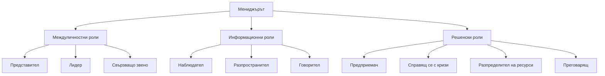
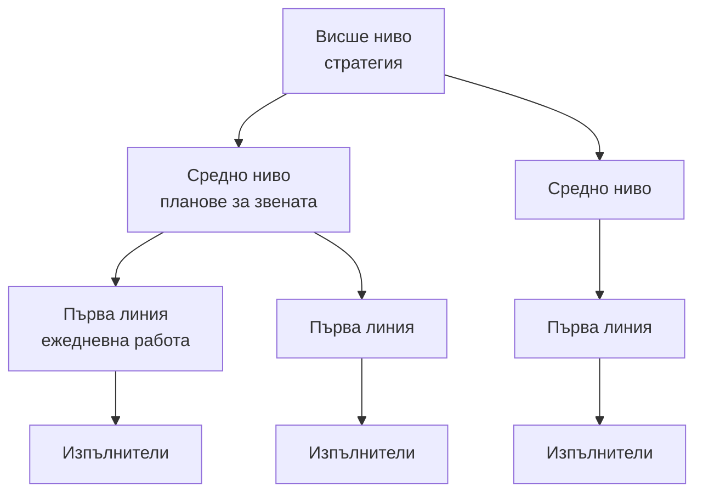

# Модул 04. Роли, нива и реална работа на мениджъра

## Цели на урока

След този урок ученикът може да:

* обясни какво е открил Хенри Минцбърг, когато наблюдава реални мениджъри;
* разпознае десетте управленски роли в три групи в конкретни ситуации;
* различи трите управленски нива: висше, средно и първа линия;
* свърже нивата с техническите, човешките и концептуалните умения;
* анализира работен ден на мениджър и да открие кои роли доминират.

## 1. Какво всъщност прави мениджърът?

В модул 03 научи, че мениджърът планира, организира, води и контролира. Звучи подредено. Но ако наблюдаваш истински мениджър един ден, ще видиш нещо съвсем различно.

Точно това прави канадският изследовател **Хенри Минцбърг** в края на 60-те години. Той следва петима директори минута по минута в продължение на седмица и записва всичко. Резултатите са публикувани през 1973 г. в книгата „Природата на управленската работа“.

Какво открива:

* Работата е **накъсана**: средно една дейност трае под 9 минути.
* Работата е **бърза**: мениджърите рядко имат половин час без прекъсване.
* Работата минава **основно в разговори**: около 2/3 от времето е за срещи и телефон.
* Мениджърите предпочитат **живата информация** (разговор, слух, телефон) пред писмените отчети.

Минцбърг заключава, че четирите функции описват **какво трябва да се постигне**, но не и **какво реално прави** мениджърът. За това той предлага **десет роли**.

> **Опитай сам.** Наблюдавай класния си ръководител в едно междучасие или в началото на час. Колко различни неща прави за 10 минути? Запиши ги.

## 2. Десетте роли на Минцбърг

Ролите са в три групи.

### 2.1. Междуличностни роли: работа с хора

| Роля | Какво прави | Пример |
|---|---|---|
| **Figurehead** (представител) | Символично представя организацията | Кметът реже лентата на новия парк; директорът връчва дипломите |
| **Leader** (лидер) | Мотивира, развива и насочва екипа | Треньорът говори с отбора на почивката |
| **Liaison** (свързващо звено) | Поддържа контакти извън своя екип | Управителката на магазин поддържа връзка с колегите си от други обекти |

### 2.2. Информационни роли: движение на информацията

| Роля | Какво прави | Пример |
|---|---|---|
| **Monitor** (наблюдател) | Следи отчети, пазар, конкуренти | Собственикът на кафене проверява какви цени има новото кафене отсреща |
| **Disseminator** (разпространител) | Предава информация **вътре** в екипа | Шефът на смяната обяснява новите правила за хигиена |
| **Spokesperson** (говорител) | Говори от името на организацията **навън** | Изпълнителният директор дава интервю за bTV |

### 2.3. Решенски роли: вземане на решения

| Роля | Какво прави | Пример |
|---|---|---|
| **Entrepreneur** (предприемач) | Стартира промени и нови идеи | Управителят пуска нова услуга: доставка до дома |
| **Disturbance handler** (справящ се с кризи) | Гаси пожари, реагира на неочаквани проблеми | Касовата система спира в пика на продажбите |
| **Resource allocator** (разпределител на ресурси) | Решава кой какво получава: пари, хора, време | Разпределя бонус бюджета между екипите |
| **Negotiator** (преговарящ) | Договаря с доставчици, партньори, синдикати | Преговаря за по-ниска цена с доставчика на мляко |

Ролите не се изключват. В един разговор мениджърът може да е едновременно наблюдател (научава нещо), разпространител (предава го на екипа) и предприемач (решава да промени нещо).

### Пример: директорката на училище в един ден

Г-жа Николова е директор на училище в Пловдив. Сутринта открива тържество за 100 години от основаването (**представител**). След това разговаря с млада учителка, която мисли да напусне (**лидер**). Обажда се на колега от друго училище за общ проект по Еразъм+ (**свързващо звено**). Преглежда резултатите от НВО спрямо средните за областта (**наблюдател**). На педагогическия съвет обяснява новите изисквания на министерството (**разпространител**). Следобед дава интервю за местно радио (**говорител**). Стартира идея за клуб по роботика (**предприемач**). Реагира, когато в една класна стая се спуква тръба (**справящ се с кризи**). Решава как да раздели средствата за нови компютри (**разпределител**). Договаря с фирма за по-ниска цена на кетъринга (**преговарящ**).

Десет роли в един ден. Точно това описва Минцбърг.

> **Опитай сам.** Кои три роли изпълнява най-често капитанът на спортен отбор? А председателят на ученическия съвет?

## 3. Трите управленски нива

Не всички мениджъри правят едно и също. Колкото по-високо е нивото, толкова по-широк е погледът.

| Ниво | Кой е | С какво се занимава | Хоризонт |
|---|---|---|---|
| **Висше** (top management) | Изпълнителен директор, съвет на директорите | Стратегия, посока на цялата организация | 3 до 10 години |
| **Средно** (middle management) | Регионален мениджър, ръководител на отдел | Превръща стратегията в планове за звената | 6 месеца до 2 години |
| **Първа линия** (first-line) | Управител на обект, шеф на смяна, бригадир | Ежедневната работа на изпълнителите | ден, седмица, месец |

## 4. Трите вида умения на Кац

Американският психолог **Робърт Кац** (1955) описва три вида умения, които трябват на мениджъра:

* **Технически умения:** знаеш как се прави работата. Касовият софтуер, лекарствата, складът.
* **Човешки умения:** работиш с хора. Мотивираш, изслушваш, решаваш конфликти.
* **Концептуални умения:** виждаш цялото. Връзките между частите, пазара, бъдещето.

Пропорцията се сменя според нивото. Пример: верига аптеки.

| Ниво | Пример | Технически | Човешки | Концептуални |
|---|---|---|---|---|
| Висше | Изпълнителен директор на веригата | ниско | високо | много високо |
| Средно | Регионален мениджър на 12 аптеки | средно | високо | средно |
| Първа линия | Управител на една аптека | високо | високо | ниско |

**Човешките умения са нужни на всяко ниво.** Те са единствените, които не намаляват при изкачване.

### Пример: от магистър-фармацевт до регионален мениджър

Радост е магистър-фармацевт в аптека в Стара Загора. Знае всяко лекарство, всеки код в софтуера (техническо умение). Повишават я за управител на аптеката: вече трябва да прави графици, да решава спорове между колегите (човешко умение). След три години става регионален мениджър на 12 аптеки. Сега рядко консултира клиенти. Трябва да разбере защо аптеките в по-малките градове губят клиенти и какво да направи веригата срещу онлайн аптеките (концептуално умение).

Технически умения, които са я направили отличен фармацевт, вече не са достатъчни. Трябва да развие нови.

> **Опитай сам.** Помисли за мечтаната си професия. Ако след 15 години си ръководител в нея, кое умение ще трябва да развиеш най-много?

## 5. Реалната работа: един вторник от живота на управителката

Ива управлява магазин за спортни стоки в Пловдив. Ето нейния вторник:

| Час | Какво прави Ива | Роля по Минцбърг |
|---|---|---|
| 08:40 | Преглежда вчерашния оборот и го сравнява с плана | ? |
| 10:15 | Двама продавачи искат един и същ ден отпуск | ? |
| 11:30 | Обяснява на екипа новата промоция от централата | ? |
| 13:00 | Договаря с доставчик по-ранна доставка на ски | ? |
| 15:20 | Касовата система спира при опашка от 15 души | ? |
| 17:00 | Решава как да раздели бонус бюджет от 600 € | ? |
| 18:30 | Дава интервю за местна телевизия за новия щанд | ? |

Някои моменти имат два верни отговора. Например конфликтът за отпуска в 10:15 е и решаване на криза (кой ще работи?), и разпределяне на ресурс (времето на хората), и роля на лидер (как да говори с двамата, без да загуби мотивацията им).

> **Опитай сам.** Попълни третата колона. За моментите с два възможни отговора запиши и двата и обясни.

## 6. Защо всичко това е важно за теб

Ролите на Минцбърг не са само за мениджъри. Капитанът на отбора, отговорникът на класа, координаторът на групов проект изпълняват същите роли в малък мащаб.

Когато разбираш ролите, можеш да:

* видиш коя роля **пропускаш** (най-често: свързващо звено и наблюдател);
* разбереш защо се чувстваш **разпилян** (защото работата наистина е накъсана, не защото си лош организатор);
* разпределиш ролите в екипа, вместо да ги поемаш всичките сам.

## Въпроси за дискусия

1. Минцбърг открива, че мениджърите предпочитат разговора пред писмения отчет. Добре ли е това? Какви рискове носи?
2. Може ли един човек да изпълнява и десетте роли добре? Какво правим, ако не може?
3. Защо човешките умения са нужни на всяко ниво?
4. Кое ниво на управление ви изглежда най-трудно? Защо?

## Ключови термини

| Термин | Значение |
|---|---|
| Interpersonal roles | междуличностни роли: представител, лидер, свързващо звено |
| Informational roles | информационни роли: наблюдател, разпространител, говорител |
| Decisional roles | решенски роли: предприемач, справящ се с кризи, разпределител на ресурси, преговарящ |
| Top / middle / first-line management | висше / средно ниво / първа линия на управление |
| Technical skills | технически умения |
| Human skills | човешки умения |
| Conceptual skills | концептуални умения |
