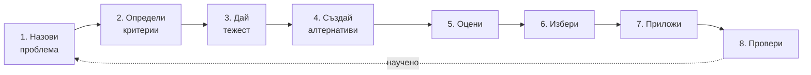

# Модул 05. Управленското решение като процес

## Цели на урока

След този урок ученикът може да:

* опише процеса на вземане на решение в осем стъпки;
* разграничи програмирани от непрограмирани решения;
* различи условия на сигурност, риск и неопределеност;
* пресметне очаквана стойност при решение в условия на риск;
* построи и използва матрица на решенията с тежести.

## 1. Решението е процес, не момент

Когато кажем „той взе решение“, си представяме момент: човек казва „да“ или „не“. Но изборът е само една стъпка. Преди него трябва да разберем проблема и вариантите. След него трябва да го приложим и да проверим дали е сработил.

Повечето лоши решения не са лоши в момента на избора. Лоши са, защото:

* сме решили **грешния проблем**;
* сме разгледали **само един вариант**;
* не сме казали предварително **по какво ще сравняваме**;
* никой не е **проверил** какво се е случило после.

## 2. Осем стъпки от проблема до проверката

| Стъпка | Въпрос | Типична грешка |
|---|---|---|
| **1. Назови проблема** | Какво точно не е наред и откога? | Бъркаме симптома с причината |
| **2. Определи критерии** | По какво ще познаем доброто решение? | Измисляме критериите, след като вече харесваме вариант |
| **3. Дай тежест** | Кое е по-важно: цена, срок или качество? | Всички критерии са „еднакво важни“ |
| **4. Създай алтернативи** | Поне три варианта, сред тях и „нищо не правим“ | Обсъждаме само „да или не“ |
| **5. Оцени** | Сравни всеки вариант по всеки критерий | Оценяваме на усет |
| **6. Избери** | Най-високият резултат, проверен със здрав разум | Сляпо следваме числото |
| **7. Приложи** | Кой, какво, до кога, с какъв бюджет | Решаваме, но никой не прави нищо |
| **8. Провери** | Решен ли е проблемът? Какво научихме? | Никой не поглежда назад |

### Пример: симптом или причина?

Фитнес зала в Пловдив губи членове. Собственикът казва: „Проблемът е, че сме скъпи. Ще намалим цената с 20%.“

Но ако разгледа данните, ще види, че 70% от напусналите са спрели да идват след първите 3 седмици. Хората не напускат заради цената. Напускат, защото никой не им е показал как да тренират и са се отказали. Намалението на цената ще намали приходите, без да реши проблема.

Правилно назован проблем: „7 от 10 нови членове спират да идват до 3-тата седмица.“ Сега алтернативите са съвсем други: безплатна среща с треньор, програма за първия месец, напомняне по SMS.

> **Опитай сам.** „Учениците закъсняват за първия час.“ Назови поне три възможни причини. Как ще провериш коя е истинската?

## 3. Програмирани и непрограмирани решения

| | Програмирани решения | Непрограмирани решения |
|---|---|---|
| **Какви са** | Повтарят се. Има правило или процедура. | Нови, сложни, без готово правило. Искат преценка. |
| **Примери** | Поръчваме мляко, когато останат 20 кутии | Да отворим ли онлайн магазин? |
| | Връщане на стока до 14 дни по правилата | Как да реагираме на нов конкурент на съседната улица? |
| | Графикът на смените всяка седмица | Да въведем ли четиридневна работна седмица? |
| **Кой ги взима** | Често изпълнители или първа линия | Средно и висше ниво |

Колкото по-високо е нивото на мениджъра, толкова повече непрограмирани решения взима.

**Добрият мениджър превръща повтарящите се проблеми в правила**, за да има време за новите. Ако всеки път, когато клиент иска да върне стока, продавачът трябва да вика управителя, управителят няма да има време да мисли как да се справи с конкурента.

> **Опитай сам.** Посочи едно решение във вашето училище, което се взима всяка седмица отново, а може да се превърне в правило. Как би звучало правилото?

## 4. Сигурност, риск и неопределеност

Решенията се взимат при различна степен на знание за бъдещето.

| Условие | Какво знаем | Пример | Как действаме |
|---|---|---|---|
| **Сигурност** | Вариантите и резултата от всеки | Наем 1 200 € месечно за 12 месеца по подписан договор | Просто сравняваме |
| **Риск** | Вариантите и вероятностите им | От опит знаем, че 30% от хората на дегустация купуват | Смятаме очаквана стойност |
| **Неопределеност** | Не знаем вероятностите, понякога и всички варианти | Как ще реагират клиентите на изцяло нов продукт | Малки, обратими стъпки и тестове |

### 4.1. Очаквана стойност при риск

Когато знаем вероятностите, можем да сметнем **очаквана стойност**: средния резултат, ако взимахме същото решение много пъти.

**Очаквана стойност = вероятност × резултат (за всеки изход), събрани заедно**

### Пример: щанд на фестивал

Ученическа фирма решава дали да вземе щанд на фестивал в Южния парк. Щандът струва 150 €.

* Ако времето е хубаво (вероятност 70%), ще продадат за 500 €.
* Ако вали (вероятност 30%), ще продадат за 100 €.

Очакван приход = 0,7 × 500 + 0,3 × 100 = 350 + 30 = **380 €**

Очаквана печалба = 380 − 150 = **230 €**

Решението е да вземат щанда. Но обърни внимание: при дъжд ще загубят 50 €. Ако фирмата има само 100 € в касата, загубата може да е опасна. Очакваната стойност не е всичко. Трябва да питаме и **„можем ли да понесем най-лошия случай?“**

> **Опитай сам.** Ако вероятността за дъжд е 50%, а не 30%, каква е очакваната печалба? Ще вземеш ли щанда?

### 4.2. Действие при неопределеност

При неопределеност не можем да смятаме. Тогава:

* правим **малки стъпки**, които могат да се върнат назад;
* **тестваме** с малко клиенти, преди да вложим много;
* питаме **„каква е най-евтината проверка на тази идея?“**

Пример: вместо да отвори нов ресторант за веган храна за 60 000 €, готвачът първо продава веган менюта два месеца през Glovo от своята кухня. Ако се продават, отваря. Ако не, е загубил малко.

## 5. Матрица на решенията

Когато имаме няколко варианта и няколко критерия, най-ясният инструмент е **матрицата на решенията** (weighted decision matrix, матрица с тежести).

Как се прави:

1. Записваш критериите и им даваш **тежест** в проценти (общо 100%).
2. Оценяваш всеки вариант по всеки критерий от 1 до 5.
3. Умножаваш оценката по тежестта и събираш.

### Пример: кой доставчик на тениски?

Волейболният отбор поръчва 40 тениски за турнир.

| Критерий | Тежест | Доставчик А | Доставчик Б | Доставчик В |
|---|---|---|---|---|
| Цена | 40% | 5 | 3 | 4 |
| Срок | 30% | 2 | 5 | 4 |
| Качество | 20% | 3 | 4 | 2 |
| Отзиви | 10% | 4 | 3 | 2 |
| **Общо** | **100%** | **3,6** | **3,8** | **3,4** |

Сметката за Б: 0,4 × 3 + 0,3 × 5 + 0,2 × 4 + 0,1 × 3 = 1,2 + 1,5 + 0,8 + 0,3 = **3,8**

Б печели. Сега си представи, че турнирът се мести с три месеца напред и срокът спира да е важен. Тежестите се сменят: цена 55%, срок 5%, качество 25%, отзиви 15%. Сметни отново. Кой печели сега?

Това е силата на матрицата: **тя показва, че решението зависи от това какво ни е важно**. Когато се сменят приоритетите, се сменя и изборът.

### Здрав разум след сметката

Числото не решава вместо теб. След матрицата задай въпроса: „Има ли нещо, което таблицата не хваща?“ Например доставчик Б може да е спечелил, но ако е единственият, който не приема плащане по фактура, това може да е непреодолимо за клуба.

> **Опитай сам.** Избираш между три летни работи: в кафене, в лагер за деца и в онлайн магазин. Определи четири критерия, дай им тежести и попълни матрицата. Съгласен ли си с резултата?

## 6. Прилагане и проверка

Стъпки 7 и 8 са най-често пропусканите. Решението не е решение, докато не е приложено.

**Прилагането** иска отговор на четири въпроса:

* **Кой** отговаря?
* **Какво** точно ще направи?
* **До кога**?
* **С какъв бюджет**?

**Проверката** иска да се върнеш към проблема от стъпка 1 и да попиташ: „Решен ли е? Какво научихме за следващия път?“

В много компании след голям проект правят **retrospective** (ретроспекция, поглед назад): какво мина добре, какво не, какво ще направим различно.

## Въпроси за дискусия

1. Защо „нищо не правим“ трябва винаги да е една от алтернативите?
2. Кога е по-добре да вземеш бързо решение с 70% информация, отколкото бавно със 100%?
3. Кои решения в живота ви са програмирани и кои непрограмирани?
4. Може ли матрица на решенията да се използва за манипулация? Как?

## Ключови термини

| Термин | Значение |
|---|---|
| Programmed / non-programmed decisions | програмирани / непрограмирани решения |
| Certainty, risk, uncertainty | сигурност, риск, неопределеност |
| Expected value | очаквана стойност |
| Weighted decision matrix | матрица на решенията с тежести |
| Criteria | критерии за оценка |
| Retrospective | ретроспекция, анализ след приключване |
