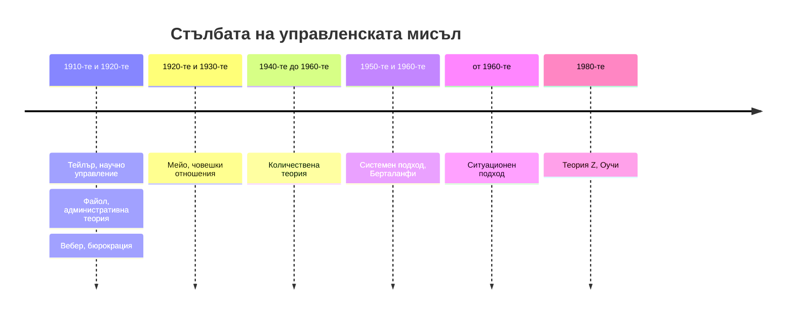
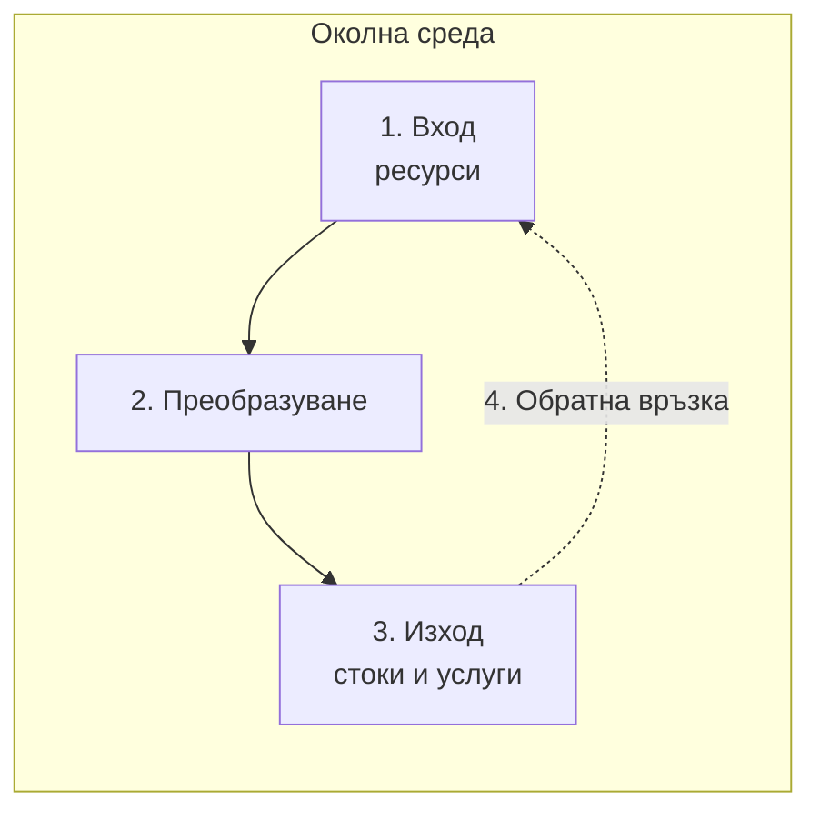

# Модул 07. Еволюция на управленската мисъл

## Цели на урока

След този урок ученикът може да:

* опише основните идеи на Тейлър, Файол и Вебер (класическа школа);
* обясни какво откриват Хоторнските експерименти (школа на човешките отношения);
* представи количествената теория, системния и ситуационния подход;
* разкаже за емпирическата школа и теория Z;
* сравни как различните школи биха решили един и същ проблем и защо няма универсален модел.

## 1. Защо историята на идеите е важна

Всеки управленски съвет, който чуваш днес, идва от някъде. „Измервай всичко“ е идея на Тейлър отпреди повече от век. „Грижи се за хората“ идва от експерименти в една американска фабрика през 20-те години. „Зависи от ситуацията“ е отговорът на 60-те.

Когато познаваш школите, можеш да разпознаеш **откъде идва** един съвет и **кога важи**.

Всяко стъпало не изтрива предишното. То добавя **нов въпрос**, който старите теории не са задавали.

| Стъпало | Школа | Основна идея | Представители |
|---|---|---|---|
| 1 | Класическа | Рационализъм: организацията като добре настроена машина | Тейлър, Файол, Вебер |
| 2 | Поведенческа | Социалната природа на човека: групата, вниманието, мотивацията | Мейо, Хоторнските експерименти |
| 3 | Количествена | Математически модели и компютри в услуга на решението | 1940-те до 1960-те |
| 4 | Системен и ситуационен подход | Организацията като цяло в среда, която постоянно се променя | Берталанфи, теория Z |

## 2. Класическа школа: как да подредим работата

### 2.1. Фредерик Тейлър (1911): научно управление

Американският инженер Тейлър работи в стоманодобивни заводи. Забелязва, че всеки работник прави една и съща задача по различен начин и много време се губи. През 1911 г. издава „Принципи на научното управление“ (scientific management).

Основни идеи:

* За всяка задача има **една най-добра техника**. Тя се открива чрез измерване с хронометър.
* Работниците се **подбират и обучават** точно за задачата.
* Заплащането е **според изработеното** (заплата на бройка).
* Планирането се отделя от изпълнението: мениджърите мислят, работниците изпълняват.

**Днес:** нормите и сканирането във всеки логистичен склад. Когато служителят в склада на eMAG сканира пратка и системата отчита колко пратки на час обработва, това е Тейлър.

**Критика:** превръща човека в част от машина. Работата става монотонна, а хората губят смисъла.

### 2.2. Анри Файол (1916): административна теория

Вече го срещна в модул 03. Файол гледа на организацията **отгоре**, от позицията на директора. Освен петте функции, той формулира **14 принципа на управлението**. Сред тях:

* **единство на командването:** всеки служител получава заповеди само от един началник;
* **разделение на труда:** специализацията повишава производителността;
* **ред:** всеки човек и всяко нещо на своето място;
* **справедливост:** доброта и честност към служителите;
* **стабилност на персонала:** честата смяна на хора е скъпа;
* **инициатива:** хората трябва да могат да предлагат.

**Днес:** организационни схеми и длъжностни характеристики във всяка фирма.

### 2.3. Макс Вебер (1922): бюрокрацията като идеален модел

Германският социолог Вебер описва **бюрокрацията** като най-рационалната форма на организация. За него думата няма отрицателния смисъл, който има днес.

Белези на идеалната бюрокрация:

* ясни, писани **правила** за всичко;
* **йерархия**: всеки знае на кого е подчинен;
* **безпристрастност**: правилата важат еднакво за всички, без лични симпатии;
* **работа по документи**: всичко се записва;
* назначаване и повишаване според **квалификацията**, не според връзките.

**Днес:** НАП, банките, всяка процедура „по правилник“. Когато в банката ти кажат „не мога, системата не позволява“, това е Вебер.

**Плюс:** справедливост и предвидимост. **Минус:** бавно, трудно се променя, хората се крият зад правилата.

> **Опитай сам.** Намери в училището по един пример за идеите на Тейлър, Файол и Вебер.

## 3. Поведенческа школа: хората не са машини

### Хоторнските експерименти (1924 до 1932)

В завода Хоторн на Western Electric край Чикаго изследователи искат да разберат как осветлението влияе на производителността. Увеличават светлината и производителността расте. После я намаляват и производителността... **пак расте**.

Професор **Елтън Мейо** от Харвард продължава изследванията и стига до извод, който променя мениджмънта: работниците работят по-добре не заради светлината, а защото **някой им обръща внимание**. Групата, вниманието и чувството, че си важен, влияят на продуктивността повече от физическите условия и парите.

Това се нарича **Хоторнски ефект**: хората променят поведението си, когато знаят, че ги наблюдават и че са важни.

Изводи на школата на човешките отношения (human relations):

* хората имат **социални нужди**, не само икономически;
* **неформалните групи** в работата имат свои правила, които понякога са по-силни от официалните;
* **вниманието и признанието** мотивират.

**Днес:** обратна връзка, тиймбилдинг, грижа за климата в екипа, анкети за удовлетвореност на служителите.

## 4. Количествена теория: решения с числа

Наричат я още **„точният мениджмънт“** или „нова класическа теория“. Развива се през 1940-те до 1960-те, заедно с първите компютри. Корените ѝ са във Втората световна война, когато математици помагат на армията да планира доставки и маршрути.

Четири характеристики:

1. Свързва се с развитието на **информатиката и изчислителната техника**.
2. Използва **математически модели**: прогнози, оптимизация, симулации.
3. В центъра е **управленското решение**: ефикасността идва от добро планиране и правилни решения.
4. Работи с **ясни, измерими критерии** за оценка.

Основната ѝ постановка е амбициозна: да замени преценката на мениджъра в най-важните моменти с **математика и компютри**.

**Днес:**

* **Логистика:** Speedy и Еконт оптимизират маршрутите на куриерите с алгоритми.
* **Търговия:** веригите прогнозират колко хляб да заредят според деня от седмицата и времето.
* **Авиация:** авиокомпаниите сменят цените на билетите според търсенето.

**Връзка с модул 06:** моделът смята бързо, но **допусканията в него са човешки**. Кой ги проверява?

## 5. Системен подход: организацията като цяло

### 5.1. Начин на мислене, не правила

Австрийският биолог **Лудвиг фон Берталанфи** (1937) предлага общата теория на системите. Идеята му: всяка организация е **единство от взаимно свързани подсистеми**.

Системният подход не е набор от правила. Той е **начин да мислим** за организацията като за едно цяло.

Три насоки:

| Насока | Какво означава | Пример от училище |
|---|---|---|
| **Система с подсистеми** | Всяка организация е единство от взаимно свързани части | Учители, администрация, ученици, родители, сграда |
| **Връзките между тях** | Подсистемите се свързват чрез формалната структура, неформалната структура и социално-психологическите връзки | Графикът и правилникът, но и приятелствата и слуховете в учителската стая |
| **Хората водят** | Водещият елемент са хората с техните потребности и интереси | Нов софтуер без обучени и мотивирани хора не променя нищо |

### 5.2. Вход, преобразуване, изход и обратна връзка

### Пример: пекарната на Мария като система

| Елемент | Какво е | При Мария |
|---|---|---|
| **Вход** | Ресурси: информационни, финансови, материални, човешки | Брашно, пекар, 2 000 € оборотни средства, рецепти |
| **Преобразуване** | Трансформация на ресурсите в нещо с по-голяма стойност | Месене, печене, подреждане на витрината |
| **Изход** | Стоки и услуги, които излизат към средата | 600 закуски на ден и бързо обслужване сутрин |
| **Обратна връзка** | Отзиви, продажби, жалби и остатъци се връщат на входа | Остават 80 кифли вечер? Утре месим по-малко |

### 5.3. Затворени и отворени системи

* **Затворена система:** не разчита на ресурсите на околната среда. За да просъществува, трябва да има вътрешни ресурси. Пример: космическа станция в изолация. В бизнеса почти не съществува.
* **Отворена система:** за да оцелее, трябва непрекъснато да търси ресурси от околната среда и да реагира на нея. Пример: всяка фирма. Пекарната купува брашно, наема хора, слуша клиентите, плаща данъци.

Опасността е организация, която **е отворена, но се държи като затворена**: не слуша клиентите, не следи пазара. Пример: Nokia и Kodak, които не реагират навреме на смартфоните и дигиталната фотография.

**Днес:** ERP системите (enterprise resource planning, системи за планиране на ресурсите на предприятието) и мисленето за цялата верига на доставки.

> **Опитай сам.** Опиши вашето училище като система: вход, преобразуване, изход, обратна връзка. Каква обратна връзка получава училището и използва ли я?

## 6. Ситуационна (вероятностна) теория: зависи от ситуацията

От 60-те години изследователи забелязват, че нито една теория не работи навсякъде. Отговорът им: **най-добрият начин зависи от ситуацията** (contingency approach).

**Характеристики:**

* Ефективността на стиловете и функциите на управление варира според конкретната ситуация.
* Средата има силно въздействие върху управлението.
* Всеки управленски проблем се обуславя от факторите, които влияят на ситуацията.

**Четири фактора за преценка на ситуацията:**

1. условията на околната среда;
2. видът собственост: частна, държавна, семейна;
3. стратегиите на организацията;
4. лидерството.

**Плюсове:** помага да различаваме и решаваме проблеми в много различни ситуации.

**Критики:** рискът да стане пълна противоположност на универсалните принципи, тоест да остане без теория: „всичко зависи“.

**Днес:** стартъп и банка се управляват различно и това е нормално. В стартъп правилата са малко и всеки поема различни роли. В банката процедурите са строги, защото грешката струва пари на клиентите.

## 7. Емпирическа школа: теория от реалния опит

Правилата тук идват от **практиката на реални ръководители**, а не от лабораторията.

| Ръководител | Подход | Наследство |
|---|---|---|
| **Хенри Форд** | Ранно диктаторско предприемачество: силна воля на собственика, строг контрол, масово производство | Поточната линия и Model T |
| **Чарлз Маккормик** | Въвежда участието на работниците в управлението | Тезата: целта на мениджмънта е да изгражда хората |
| **Джеймс Линкълн** | Мениджмънт чрез поощряване и участие | Вижте правилата по-долу |

**Правилата на Линкълн:**

* Възлагай работа над силите на хората. Предизвикателството изявява доброто в човека.
* Израстването зависи от резултатите и приноса към фирмата.
* Наблягай на колективната работа. Всеки отговаря пред екипа си.
* Ти си ръководител, не началник.

## 8. Теория Z: японският модел на Уилям Оучи

През 70-те и 80-те японските компании (Toyota, Sony, Honda) изпреварват американските. Американският професор **Уилям Оучи** изследва защо и през 1981 г. публикува „Теория Z“.

За да я разберем, първо трябват две теории на **Дъглас Макгрегър** (1960):

| Теория | Как гледа на хората | Как управлява |
|---|---|---|
| **Теория X** | Хората не обичат да работят | Контрол и наказание |
| **Теория Y** | Хората търсят смисъл и отговорност, когато имат условия | Доверие и свобода |
| **Теория Z** | Интегрира положителния опит на X и Y. Хората обичат работата си, ангажирани са и отдадени | Доверие, групови решения, дългосрочна връзка |

**Пет принципа на теория Z:**

1. доверие;
2. оценка на длъжността и бавно, сигурно служебно издигане;
3. групово вземане на решения;
4. неформален, вътрешногрупов контрол;
5. групова отговорност.

**Какво обещава:** организацията се грижи за благополучието на хората на работа и извън нея и печели доживотната им лоялност. Резултатът: сигурно работно място, висока продуктивност, висок морал. Целта е достатъчно печалба за развитие и ресурси за другите цели на фирмата.

**Критика днес:** в свят, в който хората сменят работата си на всеки 2 до 4 години, обещанието за доживотна лоялност звучи трудно постижимо.

## 9. Какво взимаме от всяка теория

| Теория | Какво ни оставя |
|---|---|
| Класическа | Структурно изграждане на организацията за по-висока производителност и ефективност |
| Поведенческа | Мотивацията и подобряването на работната среда |
| Количествена | Методите: модели, изчисления, прогнози |
| Системна | Околната среда и връзките между подсистемите |
| Ситуационна | Особеностите на конкретната ситуация |

Ефективното управление стои в центъра и взима от всички. Управлението е толкова сложно, че нито една теория не стига сама.

## 10. Един проблем, осем отговора

Онлайн магазин: поръчките закъсняват с 2 дни преди Черния петък. Как би реагирала всяка школа?

| Школа | Вероятна реакция |
|---|---|
| Тейлър | Измерва всяко движение, въвежда норма и бонус на пакет |
| Файол | Изяснява кой на кого е подчинен и кой планира смените |
| Вебер | Пише процедура стъпка по стъпка и следи спазването ѝ |
| Човешки отношения | Разговаря с екипа: умора, конфликти, признание |
| Системен подход | Проследява целия поток: сайт, плащане, склад, куриер |
| Количествена теория | Строи модел на потока поръчки и изчислява колко души трябват на смяна |
| Ситуационен подход | Пита първо: сезонен пик ли е, нов екип ли е, нова система ли е? |
| Теория Z | Събира екипа, решават заедно и поемат общата отговорност за резултата |

Нито един отговор не е грешен. Въпросът е **кой пасва на тази ситуация**.

> **Опитай сам.** Изберете проблем от училището: например много ученици не предават домашните навреме. Как би реагирала всяка от осемте школи?

## Въпроси за дискусия

1. Тейлър е критикуван, че превръща хората в машини. Има ли днес професии, в които това се случва? Помислете за куриерите и складовете.
2. Защо Хоторнският ефект е важен и за учителите?
3. Може ли теория Z да работи в България днес? Какво би я затруднило?
4. Ако „всичко зависи от ситуацията“, има ли смисъл изобщо да учим теории?

## Ключови термини

| Термин | Значение |
|---|---|
| Scientific management | научно управление (Тейлър) |
| Administrative theory | административна теория (Файол) |
| Bureaucracy | бюрокрация като идеален модел (Вебер) |
| Unity of command | единство на командването |
| Human relations | школа на човешките отношения |
| Hawthorne effect | Хоторнски ефект |
| Quantitative approach | количествена теория |
| Systems approach | системен подход |
| Open / closed system | отворена / затворена система |
| Contingency approach | ситуационен (вероятностен) подход |
| ERP, enterprise resource planning | система за планиране на ресурсите на предприятието |
| Theory X, Y, Z | теории за отношението към хората в работата |
