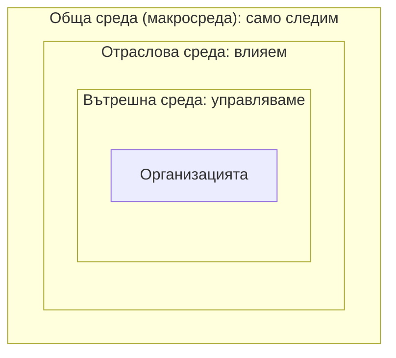
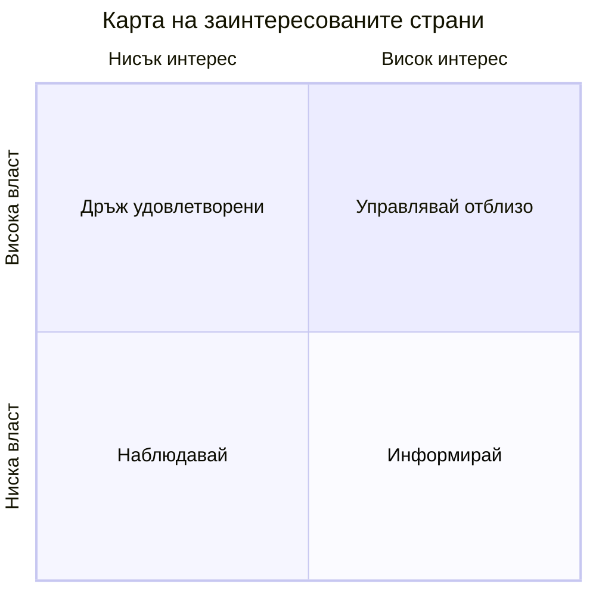

# Модул 08. Външна и вътрешна среда и международен контекст

## Цели на урока

След този урок ученикът може да:

* разграничи обща (макро), отраслова и вътрешна среда на организацията;
* направи PESTEL анализ за България през 2026 година;
* подреди stakeholders (заинтересованите страни) в матрица по власт и интерес;
* оцени институционалния и културния риск при излизане на чужд пазар;
* свърже анализа на средата с конкретни управленски решения.

## 1. Никоя организация не живее сама

В модул 07 видя, че всяка фирма е **отворена система**: взима ресурси от средата и връща продукти в нея. Сега ще разгледаме самата среда. Тя е като времето за моряка: не можеш да я контролираш, но ако не я следиш, ще потънеш.

## 2. Три пласта около всяка организация

| Пласт | Какво включва | Какво можем да направим | Пример: верига кафенета с 15 обекта в София и Пловдив |
|---|---|---|---|
| **Обща среда** (макросреда) | Политика, икономика, общество, технологии, екология, закони | Само следим и се приспособяваме | Еврото от 1 януари 2026, ръстът на заплатите, демографията |
| **Отраслова среда** | Клиенти, конкуренти, доставчици, заместители | Влияем | Starbucks, specialty (специализирани) кафенета, кафе машините в офисите |
| **Вътрешна среда** | Хора, култура, процеси, финанси, марка | Управляваме | Обучени баристи, собствено изпичане, приложение за лоялност |

> **Опитай сам.** Посочи по два фактора от всеки пласт за вашето училище.

## 3. Обща среда: PESTEL

**PESTEL** е инструмент, който подрежда факторите на общата среда в шест групи. Всяка буква е група.

### PESTEL за България през 2026 година

| Буква | Група | Какво се случва | Какво означава за бизнеса |
|---|---|---|---|
| **P** | Political (политически) | Чести избори и смяна на правителства влияят на бюджета и регулациите | Трудно дългосрочно планиране, промени в данъци и програми |
| **E** | Economic (икономически) | Еврото от 1 януари 2026, растящи заплати и наеми, поскъпване на храните | По-лесна търговия с ЕС; натиск върху разходите и цените |
| **S** | Social (социални) | Застаряващо население, миграция към големите градове, недостиг на кадри | Трудно се намират служители; нови нужди на възрастните клиенти |
| **T** | Technological (технологични) | AI в обслужването, безконтактни плащания, онлайн поръчки и доставки | Нужни са инвестиции; възможност за по-малко хора за рутинни задачи |
| **E** | Environmental (екологични) | Летни жеги, ограничения за пластмасата за еднократна употреба | Разходи за климатици, нови опаковки |
| **L** | Legal (правни) | Законът за въвеждане на еврото, GDPR, Кодексът на труда | Двойни цени в лева и евро, защита на личните данни, правила за работното време |

### PESTEL не е списък, а въпрос

Най-честата грешка е PESTEL да се превърне в дълъг списък от факти. Смисълът е в последната колона: **какво означава това за нас и какво ще направим?**

### Пример: PESTEL за веригата кафенета

* **E:** цената на кафето на зърна на световния пазар е скочила значително за последните две години. **Решение:** договор с доставчик за фиксирана цена за 12 месеца.
* **S:** недостиг на баристи. **Решение:** собствена академия за баристи с платено обучение.
* **T:** клиентите искат да поръчват предварително. **Решение:** поръчка през приложението и вземане без опашка.
* **L:** правилата за двойни цени при въвеждането на еврото. **Решение:** обновено меню и касов софтуер навреме.

> **Опитай сам.** Направи PESTEL за школа по езици в Пловдив. За всяка буква запиши фактор и решение.

## 4. Отраслова среда

Отрасловата среда са играчите, с които организацията взаимодейства всеки ден:

* **Клиенти:** кои са, какво искат, колко лесно могат да отидат при друг.
* **Конкуренти:** кои предлагат същото.
* **Доставчици:** от кого зависим, колко лесно можем да сменим доставчик.
* **Заместители:** какво друго решава същия проблем на клиента. За кафенето: кафе машината вкъщи, енергийната напитка, чаят.
* **Нови играчи:** колко лесно някой нов може да влезе на пазара.

Тези пет сили са описани от **Майкъл Портър** (1979) и се използват и днес за анализ на конкуренцията в един бранш.

## 5. Stakeholders: карта на власт и интерес

В модул 01 научи, че stakeholder е всеки, който влияе на организацията или е засегнат от нея. Но не всички са еднакво важни за всяко решение. Затова ги подреждаме по две оси:

* **Власт:** колко могат да повлияят на решението?
* **Интерес:** колко ги засяга?

| Квадрант | Стратегия | Как действаме | Пример: веригата кафенета |
|---|---|---|---|
| Висока власт, висок интерес | **Управлявай отблизо** | Чести срещи, участие в решенията | Собствениците, банката кредитор, основният доставчик на кафе |
| Висока власт, нисък интерес | **Дръж удовлетворени** | Спазвай правилата, не ги изненадвай | Общината, НАП, БАБХ |
| Ниска власт, висок интерес | **Информирай** | Редовна и честна комуникация | Служителите, редовните клиенти, съседите на обекта |
| Ниска власт, нисък интерес | **Наблюдавай** | Минимални усилия, но следи за промяна | Случайни минувачи, медии без интерес към бранша |

Позициите **не са постоянни**. Съседите имат ниска власт, докато не съберат подписка и не отидат в общината. Тогава се преместват горе. Местна медия има нисък интерес, докато не стане скандал.

> **Опитай сам.** Училището иска да удължи учебния ден с един час. Подреди в матрицата: учители, ученици, родители, РУО, министерството, транспортната фирма за училищния автобус, съседите.

## 6. Международен контекст

Когато фирма излиза извън България, средата се сменя изцяло. Двата основни вида риск са:

### 6.1. Институционален риск

Закони, данъци, бюрокрация, стабилност на правилата, корупция.

Въпроси за проверка:

* Колко време отнема да регистрираме фирма и да наемем първия човек?
* Колко са данъците и стабилни ли са правилата?
* Как се решават спорове: бързо и честно ли работят съдилищата?

### 6.2. Културен риск

Различни очаквания за йерархия, точност, пряка комуникация и несигурност.

Нидерландският изследовател **Герт Хофстеде** изследва служители на IBM в над 50 държави и описва културите по няколко измерения. Някои от тях:

| Измерение | Какво показва | Пример |
|---|---|---|
| **Дистанция на властта** | Доколко хората приемат неравното разпределение на власт | В Япония и България по-високо, в Дания и Нидерландия по-ниско |
| **Индивидуализъм** | Аз или ние | САЩ силно индивидуалистични, Япония по-колективистична |
| **Избягване на несигурност** | Колко са неудобни неясните ситуации | Германия и Япония предпочитат ясни правила и планове |
| **Дългосрочна ориентация** | Мислим за днес или за след 10 години | Япония силно дългосрочна |

### Пример: софийска IT компания излиза навън

Софийска IT компания с 60 души иска да отвори офис в Мюнхен или в Токио.

* **В Германия:** институционалният риск е нисък (ясни правила, ЕС, евро), но бюрокрацията е тежка и наемът на хора е скъп. Културата цени точността, писмените договори и прякото говорене.
* **В Япония:** институционалният риск е нисък, но езиковата бариера е огромна. Решенията често се подготвят **преди** срещата чрез **nemawashi** (предварително съгласуване: неформални разговори с всеки участник поотделно). Ако българският мениджър дойде на срещата с нова идея и очаква решение веднага, вероятно ще получи учтиво мълчание.

> **Опитай сам.** Оценете Германия и Япония от 1 до 5 по двата риска за тази компания. Защитете всяка оценка с един факт.

## 7. От анализа към решението

Всеки инструмент в този модул има смисъл само ако води до решение:

| Инструмент | Въпросът, който задава | Решението, до което води |
|---|---|---|
| PESTEL | Какво се променя около нас? | Как да се приспособим или да използваме промяната |
| Петте сили | Колко силна е конкуренцията? | Как да се отличим или да се защитим |
| Карта на stakeholders | Кой може да ни помогне или спре? | С кого и как да комуникираме |
| Хофстеде | Как мислят хората там? | Как да преговаряме и управляваме екип в чужбина |

## Въпроси за дискусия

1. Кой фактор от PESTEL ще промени най-много живота на вашето поколение в следващите 10 години?
2. Защо съседите на обект могат да се окажат по-силни, отколкото изглеждат?
3. В кое от измеренията на Хофстеде България най-вероятно се различава от Германия? Как го виждате в ежедневието?
4. Може ли една фирма да промени общата си среда? Дайте пример за голяма компания, която го е направила.

## Ключови термини

| Термин | Значение |
|---|---|
| Macro environment | обща среда, макросреда |
| Industry environment | отраслова среда |
| Internal environment | вътрешна среда |
| PESTEL | политически, икономически, социални, технологични, екологични, правни фактори |
| Porter's Five Forces | петте сили на Портър |
| Substitutes | заместители |
| Stakeholder map | карта на заинтересованите страни по власт и интерес |
| Institutional risk | институционален риск |
| Cultural risk | културен риск |
| Power distance | дистанция на властта |
| Uncertainty avoidance | избягване на несигурност |
| Nemawashi | японска практика за предварително съгласуване |
