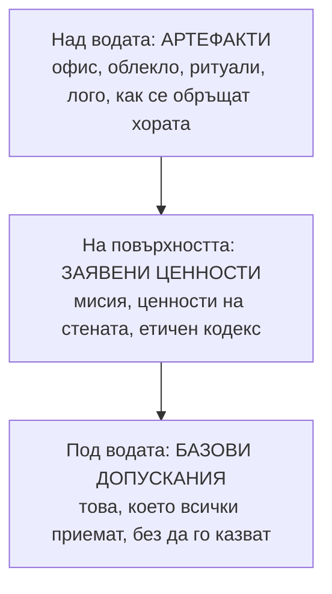

# Модул 09. Корпоративна култура: заявено и реално поведение

## Цели на урока

След този урок ученикът може да:

* обясни модела на Едгар Шайн с трите нива на културата: артефакти, заявени ценности и базови допускания;
* разграничи заявената от реалната култура на организация;
* различи силна от подходяща култура;
* свърже културата с резултатите и стратегията;
* предложи конкретни действия за промяна на поведение в екип.

## 1. Какво е корпоративна култура

Влез в две кафенета на една и съща улица. В едното баристата те поздравява по име, шегува се, музиката е силна. В другото всичко е тихо, служителите говорят само по работа, носят еднакви униформи. Двете продават кафе на една и съща цена. Но **усещането** е различно.

Това усещане е **корпоративната култура**: споделените ценности, вярвания и навици, които определят как хората в една организация мислят и се държат, особено когато никой не ги гледа.

Проста дефиниция: **културата е „как правим нещата тук“**.

> **Опитай сам.** Опиши с три думи културата на вашия клас. После с три думи културата на училището. Еднакви ли са?

## 2. Моделът на Шайн: културата е като айсберг

Американският психолог **Едгар Шайн** (MIT) описва културата на три нива. Колкото по-надолу, толкова по-трудно се вижда и толкова по-силно влияе.

| Ниво | Какво включва | Пример |
|---|---|---|
| **Артефакти** (над водата) | Видимото: офисът, облеклото, ритуалите, логото, как се обръщат хората | Няма врати между кабинетите, всички са на „ти“ |
| **Заявени ценности** (на повърхността) | Това, което казваме: мисия, ценности на стената, етичен кодекс | „Клиентът е на първо място.“ |
| **Базови допускания** (под водата) | Това, което всички приемат, без да го казват | „Който си тръгне в 18:00, не е отдаден.“ |

### Защо базовите допускания са най-важни

Артефактите са лесни за смяна: боядисваш стените, сменяш логото. Заявените ценности също: пишеш нови на стената. Но базовите допускания са **невидими** и хората често не осъзнават, че ги имат. Те определят поведението наистина.

### Пример: артефакт, който лъже

IT компания премахва вратите на кабинетите и слага маса за тенис, за да покаже „отворена култура“ (артефакт). На стената пише „Всеки може да предложи идея“ (заявена ценност). Но когато младши програмист предлага промяна на срещата, шефът го прекъсва с „Ще говорим после“. Всички научават: „Тук идеите идват отгоре“ (базово допускане).

Масата за тенис не прави културата отворена. Поведението на шефа я прави затворена.

> **Опитай сам.** Опиши културата на своето училище на трите нива. Кое ниво беше най-трудно за назоваване и защо?

## 3. Заявено и реално: къде всъщност живее културата?

Много организации имат красиви ценности, които никой не следва. Разликата между **заявеното** и **реалното** поведение е най-силният сигнал за културата.

| Заявено | Реално поведение | Какво научават хората |
|---|---|---|
| „Клиентът е на първо място“ | Бонусът зависи само от брой обаждания на час | Затваряй бързо, не решавай проблема |
| „Ценим идеите ви“ | Предложенията остават без отговор с месеци | Не си струва да предлагаш |
| „Баланс между работа и живот“ | Мениджърът пише в Slack в 23:00 и чака отговор | Трябва винаги да си на линия |
| „Учим се от грешките“ | На общата среща се търси виновен | Крий грешките |

**Правилото: културата е това, което се награждава и се търпи.** Надписът на стената е само намерение.

Ако искаш да разбереш реалната култура на една организация, не чети ценностите ѝ. Питай:

* **Кой беше повишен** последно и защо?
* **Какво се търпи**, макар да е против правилата?
* **Какво се случва**, когато някой сгреши?
* **За какво говорят** хората в кухнята, а не на срещите?

### Пример: малка грешка, голям урок

В ресторант в Пловдив нов сервитьор изпуска поднос с чаши. Ако управителят се развика пред всички, всички служители научават: „Грешката е срамна, крий я.“ Следващия път, когато някой сбърка поръчка, ще мълчи. Ако управителят каже „Случва се. Помогни ми да ги събера и внимавай с подноса, тежък е,“ всички научават: „Тук грешката се поправя, не се наказва.“

Една реакция на мениджъра учи повече от десет надписа на стената.

> **Опитай сам.** Каква е заявената ценност на вашето училище (потърси в сайта или на стената)? Как изглежда реалното поведение? Попълни ред от таблицата.

## 4. Силна или подходяща култура?

| | Силна култура | Подходяща култура |
|---|---|---|
| **Какво е** | Споделена от много хора и следвана последователно | Пасва на стратегията, клиентите и средата |
| **Плюсове** | Бързина, единство, по-малко нужда от контрол | Подкрепя това, което организацията трябва да постигне |
| **Минуси** | Трудно се променя, отхвърля различните | Може да е по-слаба, по-малко споделена |
| **Пример** | Армията, сплотен спортен отбор | Болницата има нужда от стриктност и процедури; рекламната агенция от експерименти |

**Силна, но неподходяща култура ускорява организацията в грешната посока.**

Пример: компания със силна култура на перфекционизъм („всичко трябва да е 100% преди да излезе“) е отлична за производител на самолети. Но за стартъп, който трябва бързо да тества идеи, същата култура е спирачка.

**Резултатите идват, когато културата подкрепя стратегията.** Ако обещаваме иновации, трябва да търпим разумни провали. Ако обещаваме безопасност, не можем да награждаваме бързината над процедурите.

Дракър е известен с мисълта, приписвана му често, че културата изяжда стратегията за закуска. Можеш да имаш най-добрия план, но ако културата не го подкрепя, той няма да се изпълни.

## 5. Как се променя културата

Културата не се променя с указ. Променя се, когато се сменят:

1. **Поведението на лидерите.** Хората гледат какво правят шефовете, не какво казват.
2. **Какво се награждава.** Бонуси, повишения, публично признание.
3. **Какво се търпи.** Ако някой нарушава ценност и нищо не се случва, ценността умира.
4. **Ритуалите и историите.** За какво се разказва на новите служители?
5. **Кого наемаме.** Новите хора или се приспособяват, или променят културата.

Шайн подчертава, че лидерите създават и променят културата най-вече чрез това **на какво обръщат внимание, какво измерват и как реагират в критични моменти**.

> **Опитай сам.** Искате в класа да се създаде култура „помагаме си“. Посочи по едно конкретно действие за всяка от петте точки.

## Въпроси за дискусия

1. Може ли една организация да има няколко култури? Помислете за различните отдели във фирма или различните класове в училище.
2. Защо силната култура понякога отхвърля различните хора? Добро ли е това?
3. Кой формира културата повече: директорът или учениците?
4. Как бихте разбрали реалната култура на фирма по време на интервю за работа?

## Ключови термини

| Термин | Значение |
|---|---|
| Corporate / organizational culture | корпоративна / организационна култура |
| Artifacts | артефакти, видимите белези на културата |
| Espoused values | заявени ценности |
| Basic underlying assumptions | базови допускания |
| Strong culture | силна култура |
| Fit / appropriate culture | подходяща култура |
| Culture eats strategy for breakfast | „културата изяжда стратегията за закуска“ |
