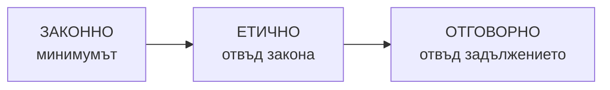
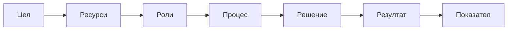

# Модул 10. Етика, stakeholders и корпоративна отговорност

## Цели на урока

След този урок ученикът може да:

* разграничи законно, етично и отговорно поведение на организация;
* обясни какво е CSR (corporate social responsibility, корпоративна социална отговорност);
* оцени последствията от решение за различните stakeholders (заинтересовани страни);
* използва четири етични подхода: последствия, права и дълг, справедливост, добродетел;
* защити управленско решение с поне два етични аргумента.

## 1. Защо етиката е управленски въпрос

Повечето управленски решения засягат хора: служители, клиенти, съседи, общество. Решение, което носи печалба, може да навреди на някого. Решение, което помага на някого, може да струва пари.

Етиката не е отделна тема след „истинския мениджмънт“. Тя е **част от всяко решение**. Въпросът не е дали мениджърът ще се сблъска с етични дилеми, а кога и дали ще ги разпознае.

## 2. Законно, етично, отговорно

| Ниво | Въпрос | Пример |
|---|---|---|
| **Законно** (минимумът) | Позволено ли е от закона? | Фирмата плаща минималната заплата и спазва Кодекса на труда |
| **Етично** (отвъд закона) | Правилно ли е, дори когато законът мълчи? | Приложение за бързи кредити не нарушава закона, но таргетира хора в отчаяние с агресивни реклами. Законно е, но неетично. |
| **Отговорно** (отвъд задължението) | Какво връщаме на общността? | Верига дарява храна с изтичащ срок на Българската хранителна банка |

**Нещо може да е напълно законно и пак да е неетично.** Законите винаги изостават от реалността. Те се пишат, след като проблемът вече се е появил. Добрият мениджър не чака закона, за да постъпи правилно.

> **Опитай сам.** Дай пример за нещо законно, но неетично, от света на социалните мрежи или онлайн игрите.

## 3. CSR: корпоративна социална отговорност

**CSR** (corporate social responsibility, корпоративна социална отговорност) е доброволната грижа на компанията за обществото и средата, отвъд това, което изисква законът.

Американският икономист **Арчи Карол** (1991) описва отговорността на бизнеса като пирамида:

| Ниво | Отговорност | Въпрос |
|---|---|---|
| 4 (връх) | **Филантропска** | Да бъдем добър гражданин: дарения, доброволчество |
| 3 | **Етична** | Да постъпваме правилно, честно, справедливо |
| 2 | **Правна** | Да спазваме закона |
| 1 (основа) | **Икономическа** | Да сме печеливши, иначе не можем да направим нищо друго |

Основата е важна: фирма, която фалира, не може да помага на никого. Но фирма, която спира на първото ниво, рискува доверието на клиентите, служителите и обществото.

### CSR или само реклама?

Някои фирми използват „отговорността“ само като реклама. Това се нарича **greenwashing** (зелено измиване), когато фирма се представя като по-екологична, отколкото е, или **social washing**, когато се преструва на социално отговорна.

Как да различиш истинския CSR:

* Свързан ли е с **основната дейност** на фирмата? (Верига за храни, която дарява храна, е по-логично от верига за храни, която спонсорира турнир по голф.)
* Продължава ли **години**, или е еднократна кампания?
* Има ли **измерими резултати**: колко тона храна, колко деца, колко дървета?
* Колко се харчи за **рекламата** на добрината спрямо самата добрина?

> **Опитай сам.** Намери пример за CSR инициатива на българска компания. Провери я по четирите въпроса. Истинска ли е или по-скоро реклама?

## 4. Четири начина да защитим решение

Философите са спорили хилядолетия какво е „правилно“. За управлението са полезни четири подхода. Всеки задава различен въпрос.

| Подход | Въпрос | Пример за мислене |
|---|---|---|
| **Последствия** (утилитаризъм) | Кое решение носи най-много полза и най-малко вреда за най-много хора? | Затваряме ли малкия обект, за да запазим 200 работни места в останалите? |
| **Права и дълг** | Нарушаваме ли нечие право, независимо от ползите? | Има граници, които не прекрачваме, дори да е изгодно: например не четем личните съобщения на служителите |
| **Справедливост** | Честно ли са разпределени ползите и тежестите? Еднакво ли третираме сходни случаи? | Защо бонусът получава само ръководството, а не екипът, който е свършил работата? |
| **Добродетел** | Какво би направил човек, на когото се възхищаваме? | Бих ли разказал решението пред семейството си? Бих ли искал да го прочета във вестника? |

**Силният аргумент използва поне два подхода и признава слабостта си.** Ако решението изглежда правилно по всичките четири, най-вероятно е добро. Ако е правилно само по едно, трябва да се замислим.

### Тестът на вестника

Прост практически тест: **„Ако утре това решение излезе на първа страница на вестник или във вирусно видео, ще мога ли спокойно да го обясня?“** Ако отговорът е „не“, вероятно нещо не е наред.

## 5. Казус: храната, която никой не купи

Верига с 40 супермаркета изхвърля всяка вечер около 1 200 кг храна с изтичащ срок. Даряването изисква логистика за 3 000 € месечно. Изхвърлянето е по-евтино и законно.

### Кой печели и кой губи?

| Stakeholder | Ако даряваме: печели | Ако даряваме: губи |
|---|---|---|
| Акционери | Доверие и репутация на марката в дългосрочен план | 3 000 € месечно, около 36 000 € годишно |
| Служители | Гордост, че работят за отговорна фирма | Допълнителна работа по сортиране и предаване |
| Клиенти | Купуват от верига, на която вярват | Нищо пряко |
| Хранителната банка и хората в нужда | Около 36 тона храна месечно | Нищо |
| Общината | По-малко отпадъци, по-малко натиск върху социалните услуги | Нищо |

### Как изглежда силен аргумент

**За даряването,** с два подхода:

* **Последствия:** 36 тона храна месечно стигат до хора, които се нуждаят, а разходът е малка част от оборота на 40 супермаркета.
* **Добродетел:** ако клиентите научат, че храна се изхвърля, докато в същия град има гладни хора, на кого биха се възхищавали? Решението минава теста на вестника.

**Слабост:** 36 000 € годишно са реален разход. Ако веригата е в загуба, може да се наложи да съкрати хора. Затова решението трябва да е свързано с измерим резултат.

### KPI, който показва, че решението работи

* Килограми дарена храна месечно (цел: над 80% от непродадената храна).
* Килограми изхвърлена храна (цел: под 200 кг на вечер за цялата верига).
* Разход за логистика на килограм дарена храна.

> **Опитай сам.** Защити обратното решение (да не дарява) с два етични подхода. Възможно ли е? Кой подход ти беше по-труден?

## 6. Изходна карта: една управленска логика

Целият курс се събира в една верига, която вече познаваш:

Всяко решение по тази верига има етична страна. Целта засяга заинтересовани страни. Ресурсите са и хора. Ролите носят отговорност. Решението има последствия. Показателят може да мери не само печалба, но и доверие.

> **Опитай сам: изходна карта.** Избери организация, която познаваш. Напиши една нейна цел, един stakeholder, едно решение с риск и един KPI.

## Въпроси за дискусия

1. Ако нещо е законно, длъжен ли е мениджърът да се замисля дали е етично?
2. Може ли фирма да прави CSR и в същото време да се държи лошо със служителите си? Как ще го забележите?
3. Кой от четирите етични подхода ви е най-близък? Защо?
4. Ако етичното решение струва работни места, кое трябва да надделее?

## Ключови термини

| Термин | Значение |
|---|---|
| Legal / ethical / responsible | законно / етично / отговорно |
| CSR, corporate social responsibility | корпоративна социална отговорност |
| Carroll's pyramid | пирамидата на Карол за отговорностите на бизнеса |
| Greenwashing | „зелено измиване“, фалшива екологичност |
| Utilitarianism | утилитаризъм, оценка по последствията |
| Rights and duties | права и дълг |
| Justice / fairness | справедливост |
| Virtue ethics | етика на добродетелта |
| Newspaper test | тестът на вестника |
